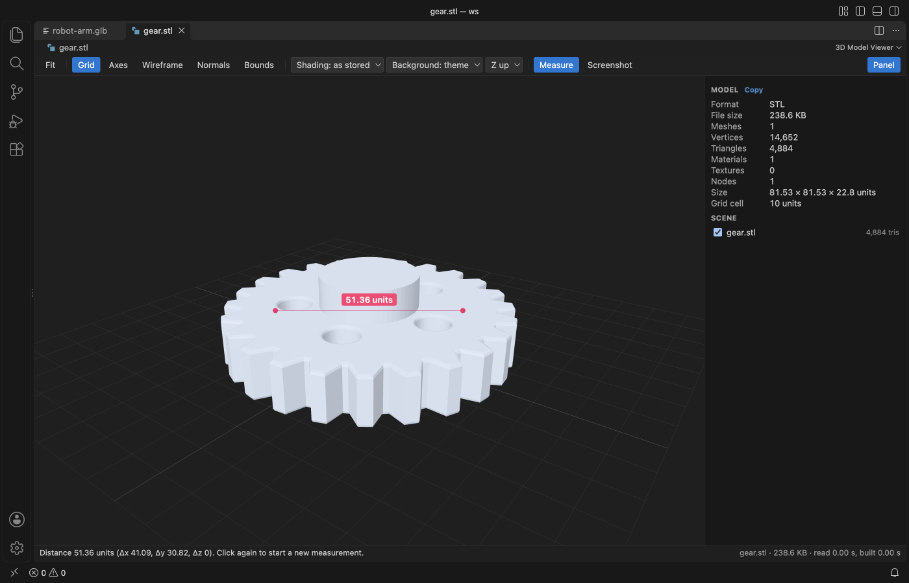
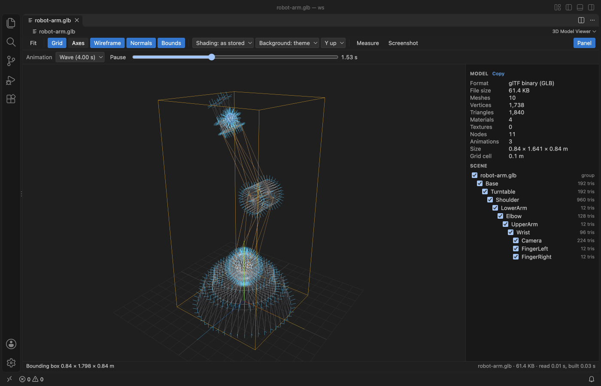
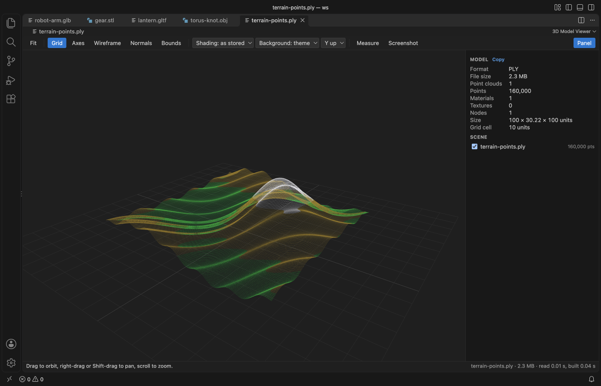
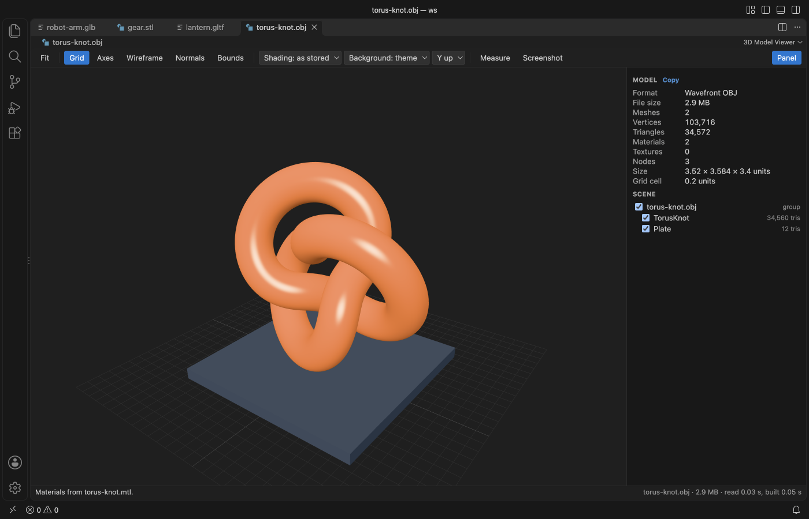

# 3D Model Viewer (GLB, glTF, STL, OBJ, PLY)

Click a `.glb`, `.gltf`, `.stl`, `.obj`, `.ply` or `.3mf` file and turn it, measure it and play its animations without leaving VS Code.

*Real output from VS Code 1.142 on macOS. The file is `robot-arm.glb`, made by `scripts/make-samples.mjs`. `scripts/e2e-vscode.mjs` installed the packaged extension in a clean VS Code profile, opened the file and saved the window through the debug port.*

- You see what is in the file. The panel counts vertices, triangles, materials and textures, gives the size in model units, and lists every node with a checkbox to hide it.
- You can check a part before you print or ship it. Click two points to get the distance with its X, Y and Z parts, and switch on wireframe, vertex normals or the bounding box.
- It stays local and light. The 344 KB install draws with three.js inside VS Code, makes no network calls, and reads `.bin` buffers, `.mtl` files and textures from the folder next to the model.

## Quick start

1. Install 3D Model Viewer.
2. Click a model file in the Explorer. Drag to orbit, right-drag or Shift-drag to pan, and scroll to zoom.

If another viewer opens, right-click the file and pick "Open in 3D Model Viewer", or use "Reopen Editor With..." from the editor title menu. "3D Model Viewer: Get Started" in the Command Palette opens a short tour.

## What it opens

| Format | Notes |
|---|---|
| GLB and glTF 2.0 | Embedded or external `.bin` buffers and textures, PBR materials, node tree, skins, morph targets and animations |
| STL | Binary and ASCII, with per-face colours when the file has them |
| OBJ | With the `.mtl` file named by `mtllib`, when it sits next to the model |
| PLY | ASCII and binary, meshes and point clouds, vertex colours |
| 3MF | Objects, build items and base material colours |

glTF files that need Draco or meshopt compression or KTX2 textures show a message that names the extension. The rest of the format list is in Limits below.

## Inspect and measure

Press Measure (or M) and click two points on the surface. The label sits on the line, and the status bar adds the X, Y and Z parts. A third click starts over and Esc stops.

| Toolbar | Key | What it does |
|---|---|---|
| Fit | F | Frames the whole model. Clicking a node name in the scene tree frames that node. |
| Grid | G | Ground grid under the model. The panel lists the cell size. |
| Axes | A | Model axes, X red, Y green, Z blue |
| Wireframe | W | Triangle edges |
| Normals | N | Vertex normals in cyan, for models up to 250,000 vertices |
| Bounds | B | Bounding box. The status bar gives its size. |
| Shading | | As stored, smooth or flat. Smooth merges shared corners, which fixes the faceted look of STL files. |
| Background | | Theme colour, dark or light |
| Up axis | | Y up or Z up. STL and 3MF open Z up and the rest Y up. |
| Measure | M | Distance between two clicked points |
| Screenshot | | Saves the view as a PNG through a save dialog |
| Panel | P | Shows or hides the stats and the scene tree |

Units come from the format. glTF is in metres and 3MF in millimetres unless the file says otherwise. STL, OBJ and PLY have no unit, so sizes are raw coordinates.

## Animations and the scene tree

glTF files with animations get a bar with a clip picker, Play and Pause (or Space) and a time slider you can drag. The scene tree lists up to 3,000 nodes with their triangle or point counts. Unchecking a node hides it and its children.

PLY files without faces open as point clouds, with their colours.

## Settings

| Setting | Default | What it does |
|---|---|---|
| `modelViewer.background` | theme | Background when a file opens, the theme editor colour, dark or light |
| `modelViewer.upAxis` | auto | Z up for STL and 3MF, Y up for the rest. Set y or z to force one. |
| `modelViewer.maxFileMB` | 1024 | Files larger than this show a message and are not read |
| `modelViewer.askForRating` | true | Ask one time for a Marketplace rating after a few days of use. Nothing is sent anywhere. |

## Privacy and safety

The extension makes no network calls and has no telemetry. The model file is never written. The only file it writes is the PNG you save with Screenshot. The webview runs under a strict Content Security Policy with no remote sources, and names from the file are shown as plain text. Sibling files (`.bin`, `.mtl`, textures) load only from the model folder and the open workspace folders.

## Limits

- Not opened: FBX, DAE, USD, STEP and IGES, and glTF 1.0.
- Draco and meshopt compressed glTF and KTX2 textures are not decoded yet. The message names the missing extension.
- The whole file is read into memory and parsed in the viewer, so the default limit is 1 GB. Files over the limit show the message and are never read. Very large meshes can take several seconds to appear.
- Fit uses the pose on screen, so an animated model can move out of the frame during a clip. Press F again.
- Measure picks the nearest visible surface. On point clouds it snaps to the nearest point within a small radius.

## More viewers by Zovo

- [Context Drift](https://marketplace.visualstudio.com/items?itemName=zovo.context-drift) finds stale facts in AGENTS.md, CLAUDE.md and other agent rule files.
- [PDF Viewer with Dark Mode](https://marketplace.visualstudio.com/items?itemName=zovo.pdf-viewer-dark) reads PDFs with a dark mode, search, an outline and thumbnails.
- [Table Viewer](https://marketplace.visualstudio.com/items?itemName=zovo.table-viewer-vscode) opens Parquet, Excel and CSV files as a sortable, filterable table.
- [DOCX Viewer](https://marketplace.visualstudio.com/items?itemName=zovo.docx-viewer-vscode) previews Word files with dark mode, an outline and search.
- [HDF5 and NetCDF Explorer](https://marketplace.visualstudio.com/items?itemName=zovo.hdf5-netcdf-explorer) browses groups, variables and attributes in scientific data files.
- [PPTX Slide Viewer](https://marketplace.visualstudio.com/items?itemName=zovo.pptx-slide-viewer) shows PowerPoint slides, thumbnails and speaker notes.
- [Skill Shelf](https://marketplace.visualstudio.com/items?itemName=zovo.skill-shelf) lists, checks and toggles the Agent Skills that Claude Code, Codex and Cursor load.
- [Tensor Viewer](https://marketplace.visualstudio.com/items?itemName=zovo.tensor-viewer) shows NPY, NPZ, Safetensors and GGUF tensors with stats and heatmaps.

## License

MIT. The viewer bundles [three.js](https://github.com/mrdoob/three.js) (MIT). See THIRD-PARTY-NOTICES.md.
