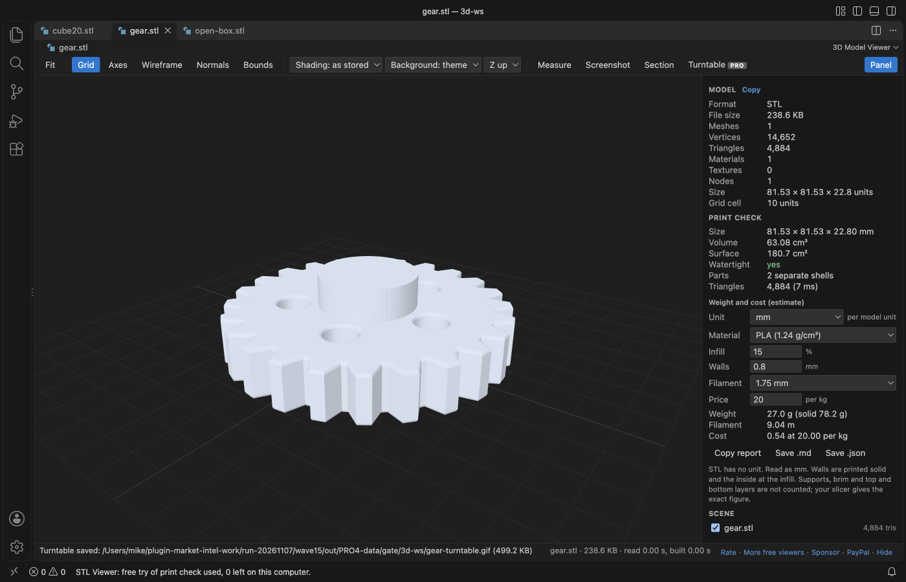
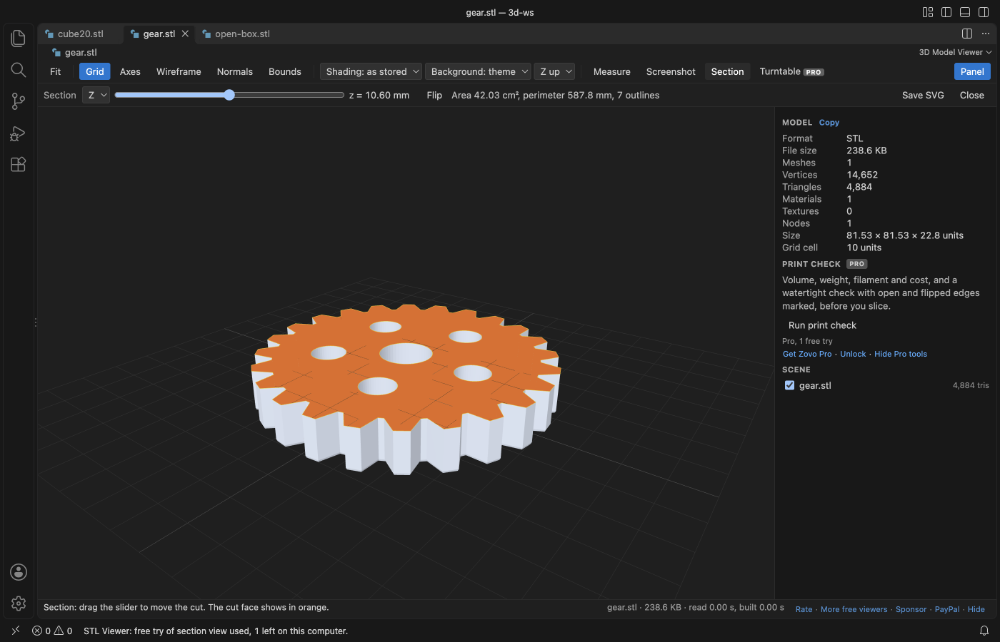

# STL Viewer, OBJ Viewer, GLB & glTF Viewer

Click a `.glb`, `.gltf`, `.stl`, `.obj`, `.ply` or `.3mf` file and turn it, measure it and play its animations without leaving VS Code.

*Real output from VS Code 1.142 on macOS. The file is `robot-arm.glb`, made by `scripts/make-samples.mjs`. `scripts/e2e-vscode.mjs` installed the packaged extension in a clean VS Code profile, opened the file and saved the window through the debug port.*

- You see what is in the file. The panel counts vertices, triangles, materials and textures, gives the size in model units, and lists every node with a checkbox to hide it.
- You can check a part before you print or ship it. Click two points to get the distance with its X, Y and Z parts, and switch on wireframe, vertex normals or the bounding box.
- It stays local and light. The viewer draws with three.js inside VS Code, makes no network calls, and reads `.bin` buffers, `.mtl` files and textures from the folder next to the model.
- Pro, if you want it: a print check (volume, weight, filament and cost, and a watertight check with the bad edges marked), a section view that cuts the model and measures the cut, and a turntable GIF export. Each Pro tool has 3 free tries. Zovo Pro is USD 19 once for every Zovo viewer.

## Quick start

1. Install 3D Model Viewer.
2. Click a model file in the Explorer. Drag to orbit, right-drag or Shift-drag to pan, and scroll to zoom.

If another viewer opens, right-click the file and pick "Open in 3D Model Viewer", or use "Reopen Editor With..." from the editor title menu. "3D Model Viewer: Get Started" in the Command Palette opens a short tour.

## What it opens

| Format | Notes |
|---|---|
| GLB and glTF 2.0 | Embedded or external `.bin` buffers and textures, PBR materials, node tree, skins, morph targets and animations |
| STL | Binary and ASCII, with per-face colours when the file has them |
| OBJ | With the `.mtl` file named by `mtllib`, when it sits next to the model |
| PLY | ASCII and binary, meshes and point clouds, vertex colours |
| 3MF | Objects, build items and base material colours |

glTF files that need Draco or meshopt compression or KTX2 textures show a message that names the extension. The rest of the format list is in Limits below.

## Inspect and measure

Press Measure (or M) and click two points on the surface. The label sits on the line, and the status bar adds the X, Y and Z parts. A third click starts over and Esc stops.

| Toolbar | Key | What it does |
|---|---|---|
| Fit | F | Frames the whole model. Clicking a node name in the scene tree frames that node. |
| Grid | G | Ground grid under the model. The panel lists the cell size. |
| Axes | A | Model axes, X red, Y green, Z blue |
| Wireframe | W | Triangle edges |
| Normals | N | Vertex normals in cyan, for models up to 250,000 vertices |
| Bounds | B | Bounding box. The status bar gives its size. |
| Shading | | As stored, smooth or flat. Smooth merges shared corners, which fixes the faceted look of STL files. |
| Background | | Theme colour, dark or light |
| Up axis | | Y up or Z up. STL and 3MF open Z up and the rest Y up. |
| Measure | M | Distance between two clicked points |
| Screenshot | | Saves the view as a PNG through a save dialog |
| Panel | P | Shows or hides the stats and the scene tree |

Units come from the format. glTF is in metres and 3MF in millimetres unless the file says otherwise. STL, OBJ and PLY have no unit, so sizes are raw coordinates.

## Animations and the scene tree

glTF files with animations get a bar with a clip picker, Play and Pause (or Space) and a time slider you can drag. The scene tree lists up to 3,000 nodes with their triangle or point counts. Unchecking a node hides it and its children.

PLY files without faces open as point clouds, with their colours.

## Settings

| Setting | Default | What it does |
|---|---|---|
| `modelViewer.background` | theme | Background when a file opens, the theme editor colour, dark or light |
| `modelViewer.upAxis` | auto | Z up for STL and 3MF, Y up for the rest. Set y or z to force one. |
| `modelViewer.maxFileMB` | 1024 | Files larger than this show a message and are not read |
| `modelViewer.askForRating` | true | Ask for a rating after models opened without an error in 2 sessions at least 4 hours apart. "Later" asks one more time after 7 days, "No thanks" never again. It never asks after an error. In Cursor, Windsurf and VSCodium "Rate it" opens Open VSX. Turn it off with `false`. |
| `modelViewer.showSupportLinks` | true | Show the small Sponsor and More free viewers links in the status line. |
| `modelViewer.showProFeatures` | true | Off: hide the Pro tools (Print check, Section, Turntable), their PRO badges and the Zovo Pro commands, so you see only the free viewer. With a Zovo Pro license they always show. |

## Pro tools for 3D printing and sharing

Everything above is free and stays free. Three tools for people who print or ship models are part of Zovo Pro. Each one has 3 free tries on your computer, so you can see what it does on your own files first.

### Print check

Press "Run print check" in the side panel before you slice. It gives the size, volume and surface area, and checks whether the mesh is watertight: open edges, non-manifold edges, faces that point the wrong way, zero-area triangles and the number of separate parts. "Mark problems" draws the bad edges on the model, open ones in red and the rest in magenta. Pick a material (PLA, PETG, ABS, ASA, TPU, nylon, PC or resin), the infill, the wall thickness, the filament diameter and your price per kg, and it estimates the weight, the filament length and the material cost. Copy the report, or save it as Markdown or JSON. STL, OBJ and PLY have no unit, so the check reads them as millimetres; change the unit in the panel if your file uses another one.

### Section view

Press Section to cut the model with a plane along X, Y or Z and move it with the slider. The cut face shows in orange, its outline in yellow, and the bar gives the area and perimeter of the cut and the number of outlines. Flip shows the other half. "Save SVG" writes the outline as a drawing in millimetres, with holes cut out, for a laser cutter or a drawing.

### Turntable export

Press Turntable and pick a size: a GIF of 480 × 480, 640 × 480 or 800 × 600 pixels that turns 360 degrees in 3 to 6 seconds, or 72 numbered PNG frames for a video tool. It uses the view, lights and background you set. Esc stops it.

A free try of the print check or the section view covers one open file tab, so you can change the settings and run it again in that tab. A turntable try is used only when the file is saved; a cancelled or stopped export costs nothing.

### Getting Pro

Zovo Pro is USD 19 once, on GitHub Sponsors (the ["$19 one time" tier](https://github.com/sponsors/theluckystrike/sponsorships?tier_id=679878)) or by PayPal, and it unlocks the Pro features in every Zovo VS Code viewer: this one, [Hex Viewer](https://marketplace.visualstudio.com/items?itemName=zovo.zovo-hex-viewer) and [DOCX Viewer](https://marketplace.visualstudio.com/items?itemName=zovo.docx-viewer-vscode) today, and the Pro features other Zovo viewers get later. See [what Zovo Pro includes](https://theluckystrike.github.io/zovo-plugin-factory/pro.html).

- "Get Zovo Pro" (in the panel, or the command "3D Model Viewer: Get Zovo Pro") opens the Zovo Pro tier on GitHub Sponsors in your browser.
- Then run "3D Model Viewer: Unlock Zovo Pro with GitHub Sponsors". VS Code asks you to sign in with GitHub, and the viewer asks GitHub one question: has this account bought the Zovo Pro tier? If you bought it before, or you have a monthly sponsorship of USD 10 or more that is still running, this is all you need. The "$15 one time" and "$5 a month" tiers on the same page are for Obsidian plugins and do not include Zovo Pro.
- No GitHub account? Send USD 19 to [paypal.com/paypalme/najzzz/19](https://www.paypal.com/paypalme/najzzz/19) with "Zovo Pro" in the note, and you get a license key by email within a day.
- If you got a license key (it starts with ZOVO1.), paste it with "3D Model Viewer: Enter Zovo Pro License Key". The key is checked on your computer and kept in VS Code's secret storage.
- "3D Model Viewer: Remove Zovo Pro from This Editor" removes it.

Nothing about Pro shows up on its own: there is no popup when a file opens, no counter and no reminder. A Pro tool explains itself only when you click it after its free tries. `modelViewer.showProFeatures: false` hides the Pro tools.

## Privacy and safety

The extension has no telemetry and makes no network calls, except one call to GitHub when you choose "Unlock Zovo Pro with GitHub Sponsors" (a monthly sponsor gets one silent recheck every 30 days). A license key is checked on your computer. "Get Zovo Pro" opens a page in your browser. The model file is never written. The extension writes only the files you save: the Screenshot PNG, and with Pro the print check report, the section SVG and the turntable GIF or PNG frames. The webview runs under a strict Content Security Policy with no remote sources, and names from the file are shown as plain text. Sibling files (`.bin`, `.mtl`, textures) load only from the model folder and the open workspace folders.

## Limits

- It does not open FBX, DAE, USD, STEP, IGES or glTF 1.0 files.
- Draco and meshopt compressed glTF and KTX2 textures are not decoded yet. The message names the missing extension.
- The whole file is read into memory and parsed in the viewer, so the default limit is 1 GB. Files over the limit show the message and are never read. Very large meshes can take several seconds to appear.
- Fit uses the pose on screen, so an animated model can move out of the frame during a clip. Press F again.
- Measure picks the nearest visible surface. On point clouds it snaps to the nearest point within a small radius.
- The print check and the section view read the visible meshes in their rest pose, up to 3 million triangles. Hide parts in the scene tree to check one part. Point clouds have no volume, so these two tools need a mesh.
- The weight is an estimate: walls are counted solid and the inside at the infill. Supports, brim and the top and bottom layers are not counted; your slicer gives the exact figure.

## Support Zovo

Zovo extensions are free, with no ads and no tracking. They are made by [theluckystrike](https://github.com/theluckystrike) on GitHub. If this one saves you time, you can support the work:

- [Sponsor on GitHub](https://github.com/sponsors/theluckystrike)
- [PayPal](https://www.paypal.com/paypalme/najzzz)
- [Follow theluckystrike on GitHub](https://github.com/theluckystrike)

### Need your format supported?

Open a [format request](https://github.com/theluckystrike/model-viewer-vscode/issues/new?template=format-request.yml) with a sample file, and I reply there whether it can be done. For USD 299 once, through [this GitHub Sponsors tier](https://github.com/sponsors/theluckystrike/sponsorships?tier_id=679995), I add your file format or a missing feature to this extension, with tests, within 7 days.

## More tools by Zovo

- [DXF Viewer & CAD Viewer for 2D Drawings](https://marketplace.visualstudio.com/items?itemName=zovo.dxf-viewer) opens ASCII and binary DXF drawings with layers, measuring and PNG or SVG export.
- [GCode Viewer, CNC Viewer & 3D Print Preview](https://marketplace.visualstudio.com/items?itemName=zovo.zovo-gcode-viewer) shows GCode toolpaths in 3D layer by layer, with print time and filament use.
- [MP4, MOV, MKV & WebM Viewer, Video Player & Preview with Sound](https://marketplace.visualstudio.com/items?itemName=zovo.video-preview-with-sound) plays MP4, MOV, MKV and WebM files with their sound.
- [Audio Player & WAV Player, Music & Wave Viewer (MP3, FLAC)](https://marketplace.visualstudio.com/items?itemName=zovo.audio-preview-vscode) plays audio files with a waveform, a spectrogram and LUFS loudness.
- [Font Viewer, TTF Viewer, OTF & WOFF Viewer, Font Preview](https://marketplace.visualstudio.com/items?itemName=zovo.font-viewer-vscode) opens TTF, OTF, WOFF, WOFF2 and TTC fonts with a glyph grid, a type tester with variable axes and the license fields.

See [all Zovo extensions on the Marketplace](https://marketplace.visualstudio.com/publishers/zovo).

## License

MIT. The viewer bundles [three.js](https://github.com/mrdoob/three.js) (MIT). See THIRD-PARTY-NOTICES.md.
